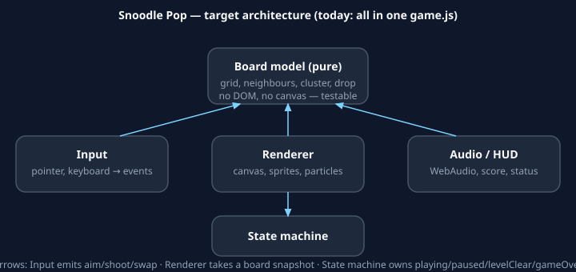

# 🫧 Snoodle Pop

<!-- VISUAL ASSET 1 — HERO SCREENSHOT — see "Visual assets" below.
     Place this block HERE, immediately after the Description paragraph
     and before "Prerequisites". Do NOT embed it until the file exists.
     File: docs/assets/screenshots/gameplay.png
     Must show: the full board at the start of level 1 (5 rows, 4 colours),
     the shooter at the bottom aimed up-left, the NEXT bubble, score/level
     HUD, and the red danger line. Capture from real play in a browser,
     480×640 canvas, no mock-up, no placeholder.
     Uncomment after capture:
     
-->

## Description

Snoodle Pop is a Snood-style bubble shooter that runs entirely in
the browser — no build step, no dependencies, no downloads, no
backend, no tracking.

Aim from the bottom, shoot a blob up into a hexagonal board, match
**3 or more** of the same colour to pop them, and drop any clusters
left floating (no longer connected to the top) for bonus points.
Clear the whole board to advance a level. Every 6 shots a new row
pushes down from the top — don't let the board cross the red
danger line.

This is a fan-style tribute inspired by the classic bubble shooter
*Snood* (1996). It is **not** Snood, is not affiliated with or
endorsed by its creators, and uses no Snood art, audio, names, or
assets — every blob face, colour, sound, and line of code here is
original. The name "Snoodle Pop" is a playful nod, not a claim to
the Snood trademark.

### How it plays

- **Aim** with the mouse, arrow keys, or your finger. The dotted
  line previews the shot, including bounces off the side walls.
- **Shoot** by clicking, pressing Space / ↑, or lifting your
  finger. Match **3 or more** of the same colour to pop them.
- **Drop clusters:** bubbles no longer connected to the top fall
  for bonus points.
- **Push pressure:** every 6 shots a new row pushes down. When a
  row is pushed, existing bubbles shift 24 px sideways as well as
  down, because board columns alternate offset by half a cell —
  that shift is intended, not a glitch.
- **Clear the board** to advance — more rows, more colours.
- **Swap** with the ⇄ button or <kbd>S</kbd> when the next bubble
  is more useful.

### Scoring

- Pop: `n × 10 + (n − 3) × 10` for a cluster of `n` (3 → 30, 4 → 50, 5 → 70).
- Floating drop: +20 per dropped bubble.
- Level clear: bonus `100 + level × 50`.
- Best score is saved in the browser (`localStorage`, key
  `snoodle-best`) and survives reloads. It is per-browser, not
  per-account, and there is no server leaderboard.

### Levels

Level 1 starts with 5 rows and 4 colours. Each level adds a row
(up to 8) and a colour (up to 6). The bubble you shoot is always
drawn from colours still on the board, so you never get stuck
with an impossible colour. The danger line is crossed when a
bubble's bottom passes it — in practice, row 11 on the
480×640 board.

## Prerequisites

- A modern web browser (Chrome, Firefox, Safari, or Edge, current
  or previous major version). No extensions, no plugins.
- For local development only: Python 3 (for the one-line static
  server below) **or** any static file server. No Node, no npm,
  no build tools are required to play or to deploy.
- For deployment only: a GitHub account, and `gh` (GitHub CLI)
  if you want to set the repo description/topics from the
  command line (optional — the web UI works too).

There is nothing to install to play the game. If you only want
to play it, skip to Deployment and open the Pages URL.

## Installation

```sh
git clone https://github.com/enonymous1/snoodle-pop.git
cd snoodle-pop
```

That's it. There is no `npm install`, no build, and no
`.env` file. The whole game is three files plus a workflow:

| File | What it is |
|---|---|
| `index.html` | Page shell, HUD, help text, overlay |
| `style.css` | Layout, responsive board, overlay |
| `game.js` | The whole game: hex grid, match-3, floating drops, row pushes, levels, particles, WebAudio blips, best score |
| `.github/workflows/pages.yml` | GitHub Actions deploy to Pages (no build) |
| `.nojekyll` | Tells GitHub Pages not to run Jekyll — kept so branch deploy also works if the workflow is ever removed |
| `LICENSE` | MIT |

## Local Development

Serve the folder from its root (not from a parent directory,
so relative paths resolve) and open it in a browser:

```sh
# From the repo root:
python3 -m http.server 8000
# then visit http://localhost:8000
```

Or just open `index.html` directly in a browser — it works
from `file://` too, because there are no imports, no fetch
calls, and no server dependency. The server route is
preferred for testing on a phone on the same network
(`http://<your-machine-ip>:8000`).

### Checks before you push

```sh
node --check game.js
test -f index.html && test -f style.css && test -f game.js
```

CI runs the same checks on every push to `main` (see
Deployment). There is currently no test suite — see
"Contributing" for the planned board-module tests.
A manual playthrough checklist, before any release:

1. Aim, bounce off a wall, pop a cluster of 3.
2. Pop a cluster that leaves a floating cluster — it
   must fall and score +20 per bubble.
3. Take 6 shots without clearing — a new row must push down.
4. Clear a board — level-clear overlay and bonus must show.
5. Let the board cross the danger line — game-over overlay
   must show, with the correct final score.
6. Pause, swap, mute, restart — all buttons and keys work.

<!-- VISUAL ASSET 2 — AIM / BOUNCE SCREENSHOT — place HERE, at the end of
     "Local Development", before "Controls".
     File: docs/assets/screenshots/aim-bounce.png
     Must show: the dotted aim line bouncing off the right wall and
     landing on a matching colour, with the shooter and NEXT bubble
     visible. Capture from real play; do not draw the line in an editor.
     Uncomment after capture:
     
-->

## Controls

| Action | Mouse / touch | Keyboard |
|---|---|---|
| Aim | Move mouse / drag finger | ← → |
| Shoot | Click / lift finger | Space / ↑ |
| Swap current ↔ next | ⇄ Swap button | S |
| Pause | ⏸ Pause button | P |
| Restart | ↻ Restart button | R |
| Sound | 🔊 button | M |

## Deployment

GitHub Pages via GitHub Actions is the canonical path.
Do **not** set Pages to "Deploy from a branch" while the
workflow exists — the two sources are mutually exclusive,
and `configure-pages` will fail if the source is not
GitHub Actions.

1. Push to `main` (see Installation for the clone URL,
   or push the export zip's repo as you normally do).
2. One-time, in the repo on GitHub: Settings → Pages →
   **Source: GitHub Actions**.
3. Push to `main` (or run the workflow manually from the
   Actions tab). The workflow checks the code
   (`node --check game.js` + required files), then
   uploads the repo root as the Pages artifact and
   deploys it. No build step.
4. Your game is at `https://enonymous1.github.io/snoodle-pop/`

To set the repo description and topics after the push
(they do not travel with `git push`):

```powershell
gh repo edit enonymous1/snoodle-pop --description 'A Snood-style bubble shooter in vanilla JS — match 3+, drop floating clusters, and clear the board before it hits the danger line.' --add-topic javascript --add-topic html5 --add-topic canvas --add-topic bubble-shooter --add-topic browser-game --add-topic github-pages
gh repo view enonymous1/snoodle-pop --json description,repositoryTopics
```

If you delete `.github/workflows/pages.yml`, switch
Pages back to "Deploy from a branch → `main` / `/ (root)`"
instead. The `.nojekyll` file is there for that case.

## Architecture

```
index.html ── loads ──► game.js ── draws ──► <canvas>
                              │  reads/writes
                              ▼
                        Board (grid: rows × 8, null | colour index)
                              │
              ┌───────────────┼───────────────┐
              ▼               ▼               ▼
           Input         Renderer          Audio / HUD
      (pointer, keys)  (canvas, faces)   (WebAudio, score)
```

Today all five boxes live in one `game.js` IIFE. The
planned split (see the staff review) is: a pure board
module with no DOM (testable), a renderer that takes a
board snapshot, an input module that emits aim/shoot/
swap events, and an audio module — with `game.js`
reduced to the state machine
(`playing | paused | levelClear | gameOver`).



*The diagram above is authored, not a screenshot: it shows the target split. Today all five boxes still live in one `game.js` file.*

## Contributing

Small, focused contributions are welcome:

- **Bug fixes first:** the snap-adjacency guard and the
  sprite-cache renderer change are the highest-value
  next patches (see the staff review, M-5 and M-3).
- **Tests:** the next test to add is a pure-function
  test for the board module once it is extracted —
  cluster search, floating drops, and snap adjacency.
  Do not add a test framework around the current
  untestable IIFE.
- **Visuals:** see "Visual assets" below — captures
  must be from real play, never mocked up.
- Keep the zero-dependency, zero-build promise. Do
  not add a bundler, framework, or backend for this
  game without discussing it first.

## Visual assets

These are the only visuals this repo needs, and where
each one goes. Capture from real play in a browser;
never fake a score, a board state, or a GIF frame in
an editor. If an asset does not exist yet, leave its
block commented out in this README — a missing image
is better than a broken image link.

| # | Asset | Must depict | File | README placement |
|---|---|---|---|---|
| 1 | Hero screenshot | Full level-1 board (5 rows, 4 colours), shooter aimed, NEXT bubble, HUD, danger line | `docs/assets/screenshots/gameplay.png` | Immediately after Description, before Prerequisites |
| 2 | Aim/bounce screenshot | Dotted preview bouncing off a wall toward a matching colour | `docs/assets/screenshots/aim-bounce.png` | End of Local Development, before Controls |
| 3 | Architecture diagram | Board / Input / Renderer / Audio / State machine, target split (authored SVG, not a screenshot) | `docs/assets/architecture.svg` | Architecture section, after the text diagram |
| 4 | Pop + drop GIF | 10–15 s loop: a match-3 pop, then a floating cluster falling for bonus points | `docs/assets/demo.gif` | How it plays, after the "Drop clusters" bullet — or, if that breaks the flow, in a "Demo" subsection directly under Description |
| 5 | Level-clear screenshot | Level-clear overlay with bonus and score, board empty | `docs/assets/screenshots/level-clear.png` | Optional gallery at the end of How it plays, or in Deployment as proof the Pages site works — do not add a fifth image to the top of the README, it dilutes the hero |

Do **not** add: a logo (the emoji title + favicon already
serve as the mark), stock photos, or a screenshot of
code. The game is the visual.

<!-- VISUAL ASSET 4 — DEMO GIF — place in "How it plays", after the
     "Drop clusters" bullet, once captured. See the table above.
     File: docs/assets/demo.gif
     Must show: real play, 10–15 s, looped, a match-3 pop followed by
     a floating-cluster drop. Record the browser, do not animate it
     in an editor.
     Uncomment after capture:
     
-->

## License

MIT — see `LICENSE`. Fork it, reskin the blobs, add levels,
make it yours.
